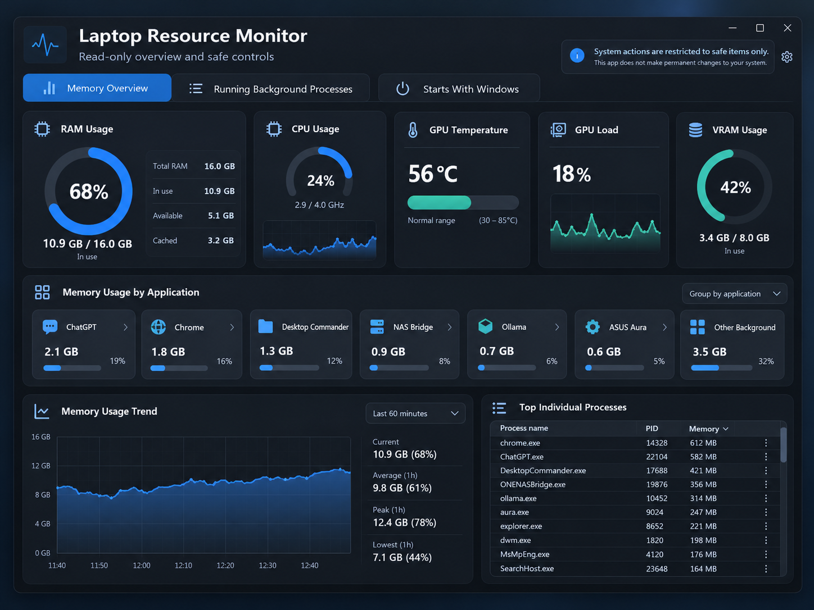
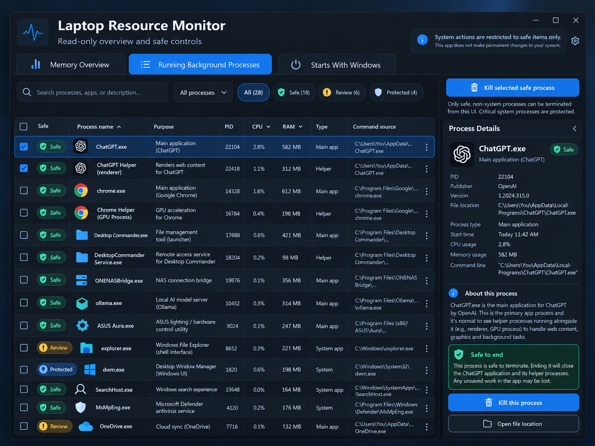
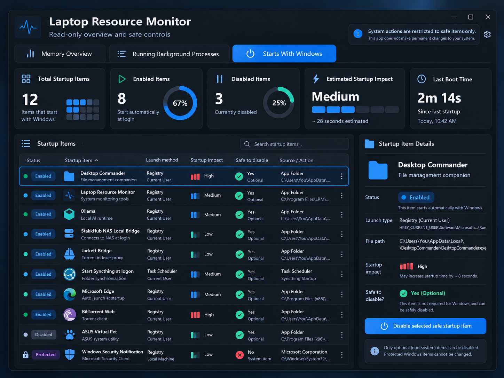

# Laptop Resource Monitor

A **free Windows resource-monitoring dashboard** developed by **Dillard's Digital Solutions**. This is an early public beta for testing and feedback.

> **Working title / naming notice (October 26, 2026):** "Laptop Resource Monitor" is a provisional project name, **not the final or official product name**, and may change before a general release. No dedicated domain name has been purchased or announced for this product. The GitHub repository and release links below are the current official download locations for this beta. Naming, domain availability, and any applicable trademark rights have **not been represented as cleared or secured**. This notice does not establish trademark protection.



## Download

Open the [latest GitHub release](../../releases/latest), download **LaptopResourceMonitor.exe**, and double-click it.

- **Windows 10 or Windows 11 (64-bit).**
- Chrome or Microsoft Edge is used to display the dashboard in its own window. No Python installation is required.
- No paid account, API key, or subscription is required.
- This public beta is **not code-signed**. Windows SmartScreen or antivirus software may warn about an unfamiliar executable. Download only from the official GitHub release and check the published SHA-256 hash. Do not disable security software just to run it.

## Three dashboard tabs

**Memory Overview** — RAM, CPU, optional NVIDIA GPU temperature/load/VRAM, application groups, memory history, and top memory-consuming processes.

**Running Background Processes** — searchable process list, process descriptions, helper-versus-main-app distinctions, RAM/CPU details, and manual process termination for a restricted allowlist only. Windows/system/unknown processes are not eligible. Every termination requires confirmation, and closing an application may lose unsaved work.

**Starts With Windows** — startup registrations from the current user's Startup folder, standard Windows Run registry keys, and selected Windows scheduled tasks. The disable control works only for a small allowlist of optional *current-user* registry entries. Other entries are read-only.

## Privacy and safety

- Operates on **your own computer** and binds to **127.0.0.1** only; it is not a remotely accessible service.
- No analytics, telemetry, user accounts, cloud sync, or advertising.
- Process command lines and startup registrations may contain sensitive local paths. They are displayed **only on your computer**; do not share unredacted screenshots publicly.
- CPU and GPU metrics are estimates; NVIDIA GPU data requires a working `nvidia-smi` executable.
- Process and startup inventories are **not exhaustive**. The app is not a replacement for Windows Task Manager, antivirus, or a professional diagnostic tool.
- Logs are stored in `%LOCALAPPDATA%\LaptopResourceMonitor\Logs`; settings/backup data stays under `%LOCALAPPDATA%\LaptopResourceMonitor`.
- Only manually confirmed, allowlisted processes can be ended. Unrecognized helpers should generally be left running.
- When in doubt, do not terminate or disable a process.

## Design previews

The following images are **UI concept artwork with example data**, not screenshots containing measured results. Actual screens display the processes and metrics from the computer where the app is running.

| Memory overview | Background processes | Windows startup |
| --- | --- | --- |
|  |  |  |

## Feedback

Report crashes, confusing labels, accessibility issues, incorrect helper classification, or feature requests in [GitHub Issues](../../issues). Include the Windows version and a description of what happened; remove usernames, paths, IP addresses, tokens, and private information from screenshots and logs.

## Run from source

Install Python 3.11+ and `psutil` on Windows:

```powershell
python -m pip install psutil
python dashboard.py
```

Optional developer test on a different local port:

```powershell
python dashboard.py --port 18768 --no-window
```

Then open `http://127.0.0.1:18768` in a local browser.

## Build a Windows EXE

```powershell
python -m pip install pyinstaller psutil
pyinstaller --noconfirm --clean --onefile --windowed --name LaptopResourceMonitor --add-data "web;web" dashboard.py
```

The executable is placed at `dist\LaptopResourceMonitor.exe`.

## License

MIT License — copyright 2026 Dillard's Digital Solutions.

**Version: 0.1.0-beta**. This is a prototype undergoing real-world testing; use at your own risk.
